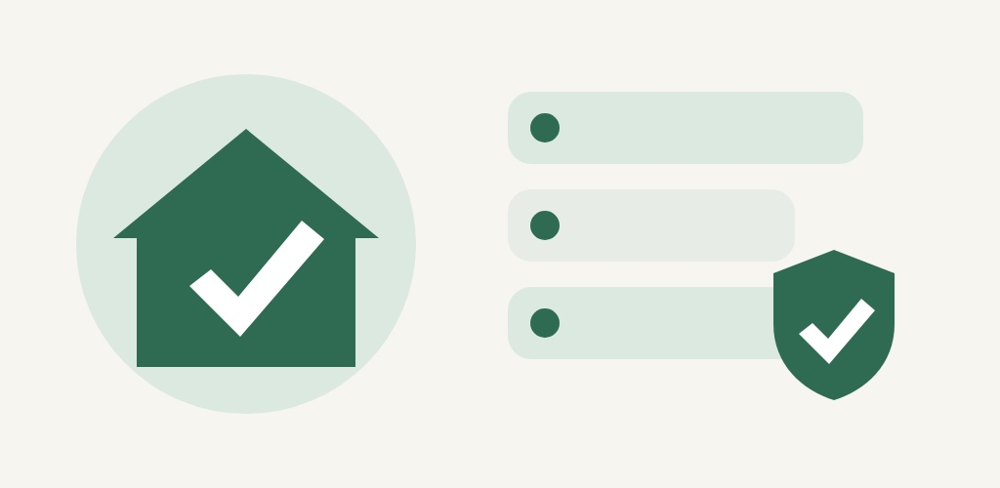
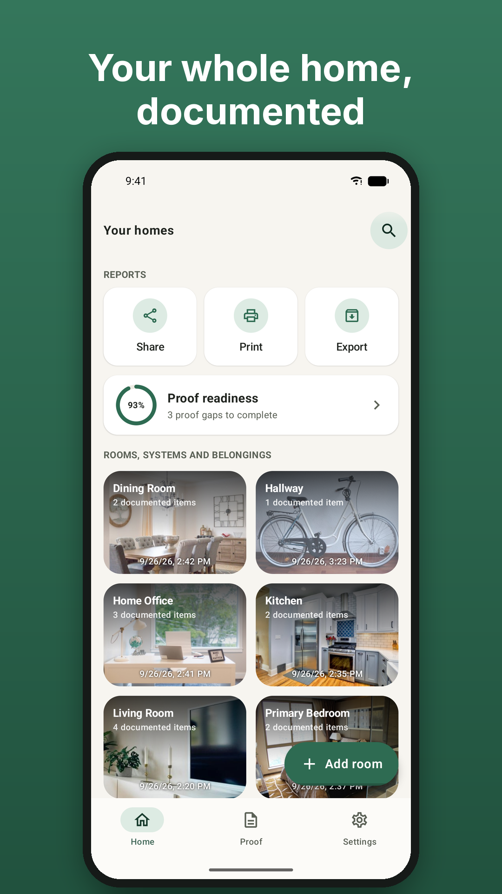
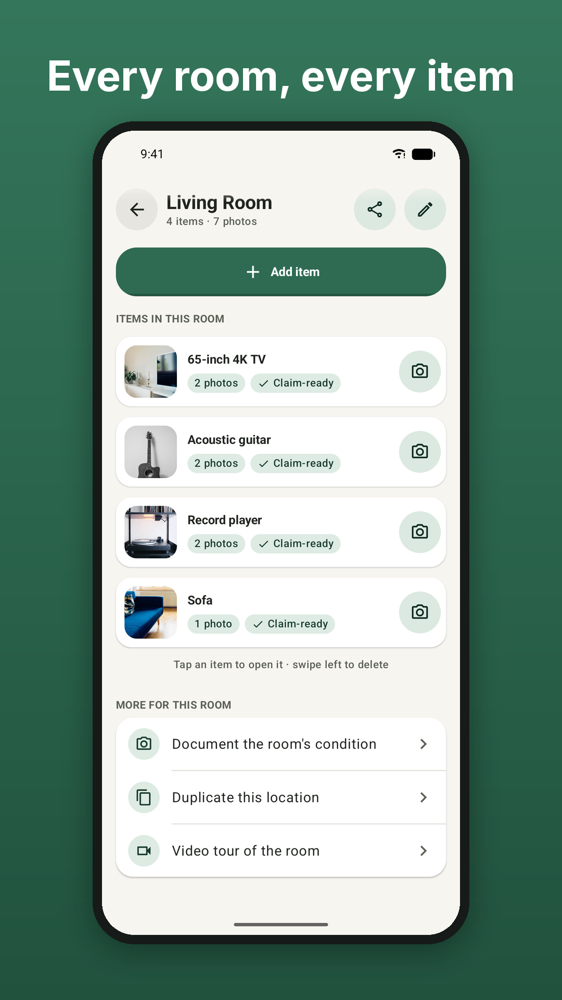
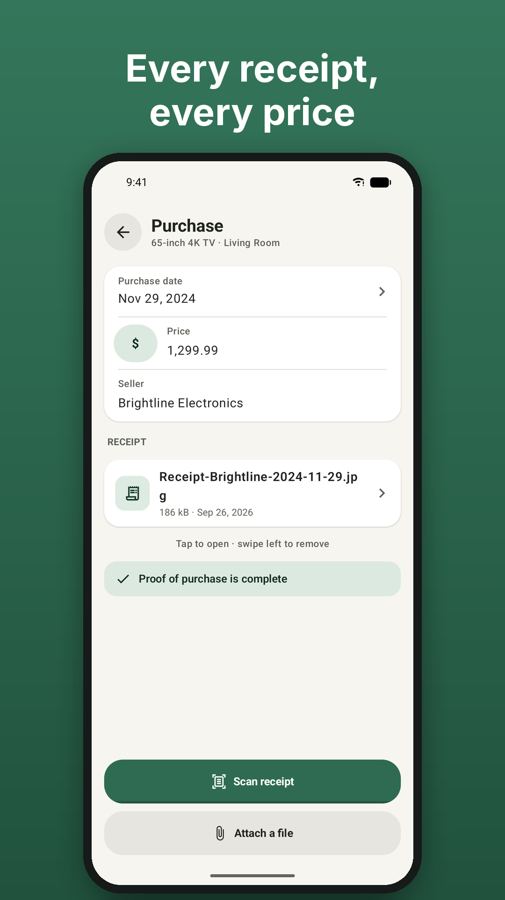
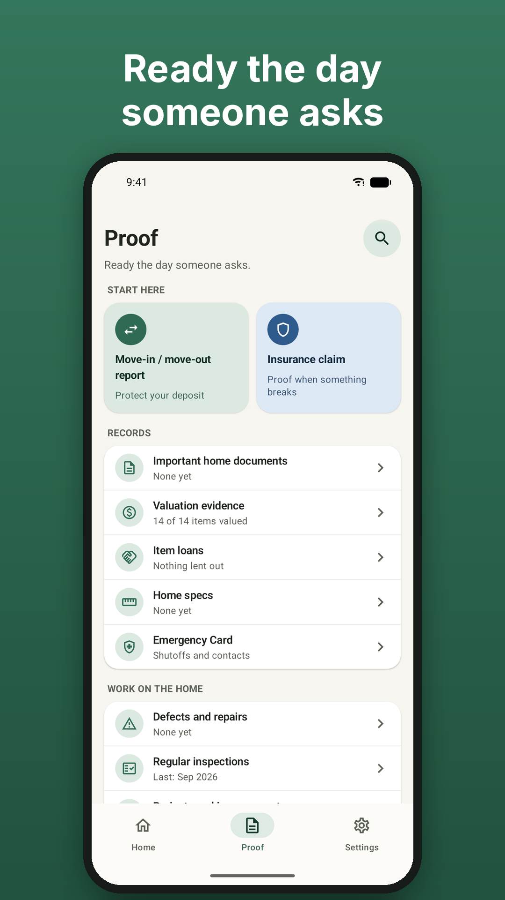
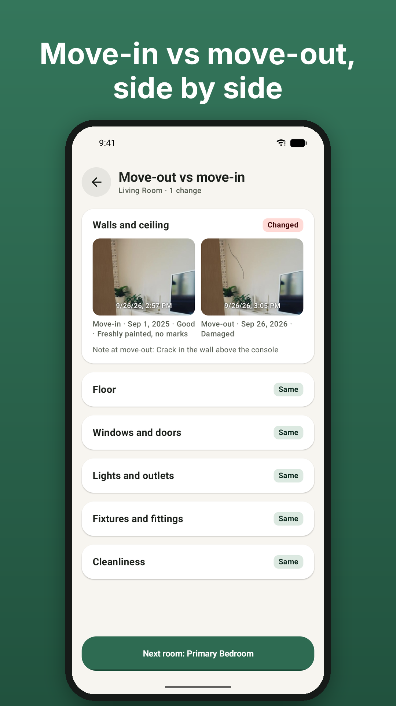
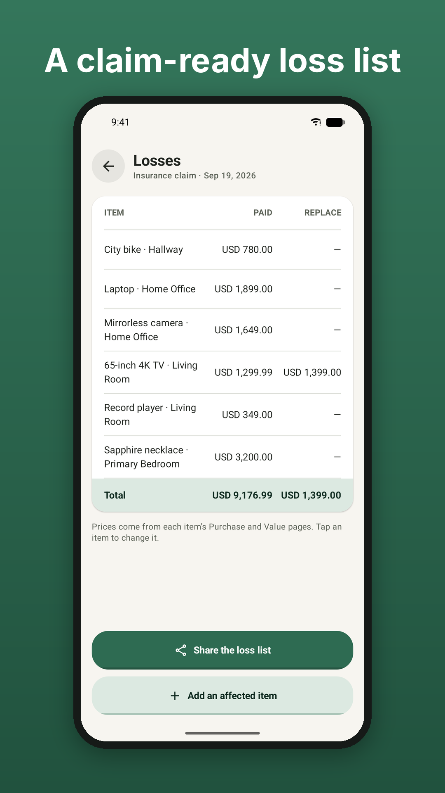
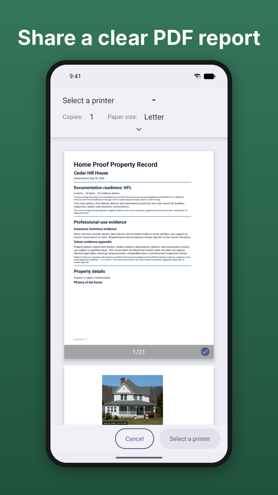
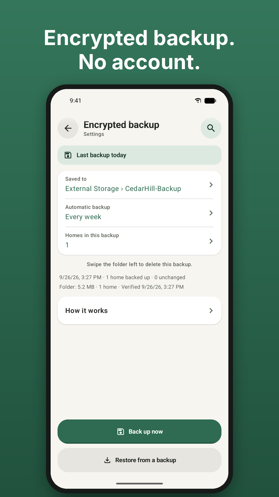
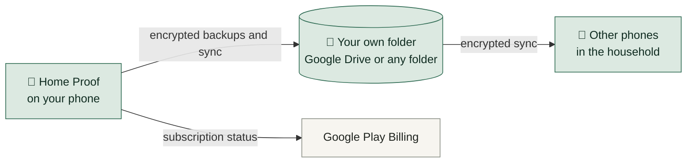

# Home Proof

**Document your home once, and have the proof ready when you need it.**

Rooms, items, serial numbers, receipts and documents — organized on your phone, dated, and ready to share as a clear report when the insurer, the landlord or the buyer asks.

 

 

 

  

  
  
  
  

  
  
  
  

   
  ▶ Watch the video

---

## 💡 Why

After a fire, a flood or a break-in, the insurer asks for the list: everything you owned, room by room, and what it cost. At the end of a lease, the landlord and the tenant argue about what the apartment looked like on day one. That proof is the hardest thing to produce after the fact — and a photo gallery is not it.

**Home Proof builds it before anyone asks.**

## ✨ What it does

<table>
  <tr>
    <td width="50%" valign="top">
      <h3>🏠 Room by room</h3>
      Photograph every room and the things in it. Add serial numbers, models, receipts, prices, warranties and documents to the item itself.
    </td>
    <td width="50%" valign="top">
      <h3>🧾 Receipts and prices</h3>
      Scan a receipt or attach a file. Each item shows when its proof of purchase is complete.
    </td>
  </tr>
  <tr>
    <td valign="top">
      <h3>📋 Insurance claim</h3>
      A loss list of the damaged items with prices and photos, in the columns an adjuster works with.
    </td>
    <td valign="top">
      <h3>🔑 Move-in / move-out</h3>
      Room-by-room condition reports with photos from both inspections side by side, signed on the phone.
    </td>
  </tr>
  <tr>
    <td valign="top">
      <h3>📄 Reports to share</h3>
      Property Record, claim file, handover and defect reports, regular inspections, and a printable emergency card — as clear PDFs.
    </td>
    <td valign="top">
      <h3>🔗 Evidence chain</h3>
      Every photo in a shared report shows the date and time it was documented, and the evidence chain shows if anything was changed later.
    </td>
  </tr>
  <tr>
    <td valign="top">
      <h3>🛠️ Maintenance plan</h3>
      A plan matched to the home, with reminders, and warranty alerts before they expire.
    </td>
    <td valign="top">
      <h3>🔄 Household sync</h3>
      Keep the household's phones in step through your own encrypted shared folder.
    </td>
  </tr>
  <tr>
    <td valign="top">
      <h3>💾 Encrypted backups</h3>
      To Google Drive or any folder, once or on a schedule. Restore and transfer whole homes with their evidence.
    </td>
    <td valign="top">
      <h3>🏢 One home or hundreds</h3>
      For homeowners, tenants, landlords, property managers and vacation-rental hosts — every property gets its own file.
    </td>
  </tr>
</table>

## 🛡️ Your data stays with you

- **No account, no ads, no server of its own.** Your records stay on your phone.
- **Encryption with a password only you know** — turn it on, and everything you document is encrypted on the phone.
- **You choose** when to export, share or back up.

Read the full [Privacy policy](https://sites.google.com/view/homeproof-privacy-policy/).

## 🌍 Nineteen languages

English · עברית · العربية · Español · Français · Deutsch · Português · Italiano · Русский · हिन्दी · Bahasa Indonesia · 日本語 · 한국어 · 简体中文 · 繁體中文 · Türkçe · Polski · Tiếng Việt · ไทย

## 💳 Price

The whole app is free for 3 days — no credit card, no sign-up. After that, a subscription keeps creating and editing: **Starter** (up to 5 homes), **Professional** (up to 20) or **Unlimited**, monthly or yearly through Google Play. Without a subscription, your records stay available to view, back up and export — they are never deleted because of billing.

---

## 🛠️ Built with

| | |
|---|---|
| **Language** | Kotlin 2.4 |
| **UI** | Jetpack Compose, Material 3, a Glance home-screen widget |
| **Data** | Room, Paging, Kotlin Coroutines, Hilt |
| **Background work** | WorkManager — scheduled backups and reminders |
| **Camera and scanning** | CameraX photos and video, ML Kit document scanner |
| **Security** | Password encryption, AndroidX Biometric app lock |
| **Payments** | Google Play Billing |
| **Analytics** | Firebase Analytics (can be switched off) and Crashlytics |
| **Android** | minSdk 28 (Android 9), targetSdk 36 |
| **iPhone and iPad** *(in development)* | Swift, SwiftUI, SwiftData, StoreKit 2, CryptoKit — no third-party libraries |

---

**Home Proof** is made by an independent developer, Eran Gross. 
It does not replace a licensed professional, an insurer or emergency services.

[Privacy policy](https://sites.google.com/view/homeproof-privacy-policy/) · © 2026 Eran Gross · All rights reserved, see [LICENSE](LICENSE) · The app's source code is private

